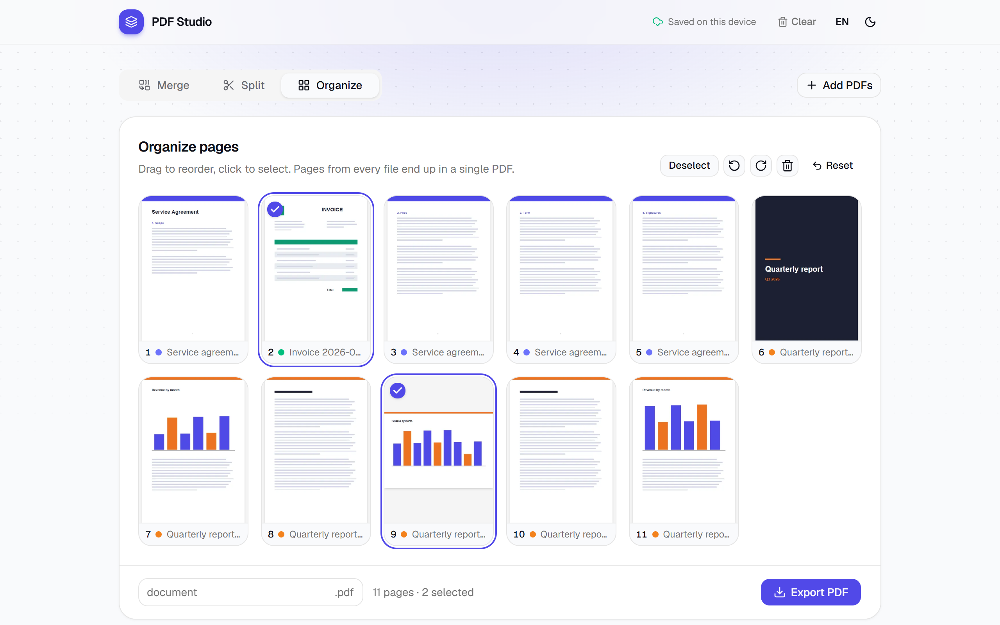
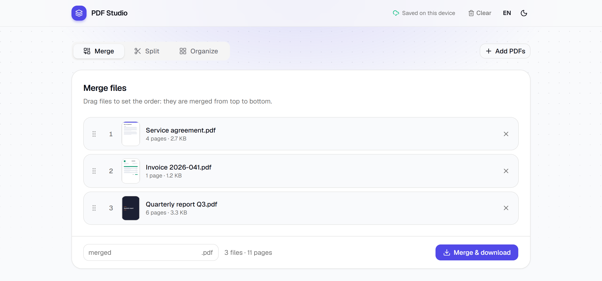
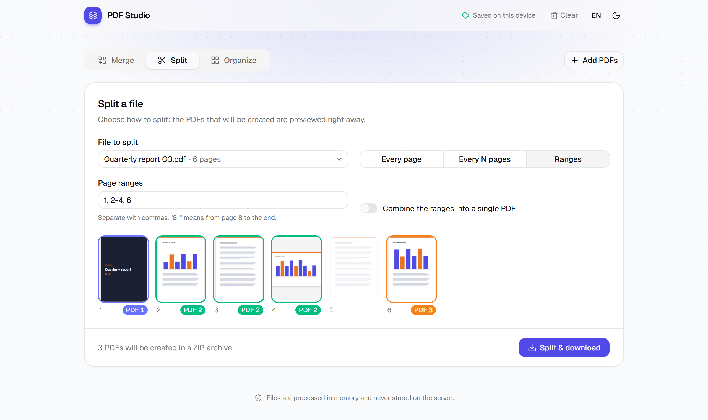
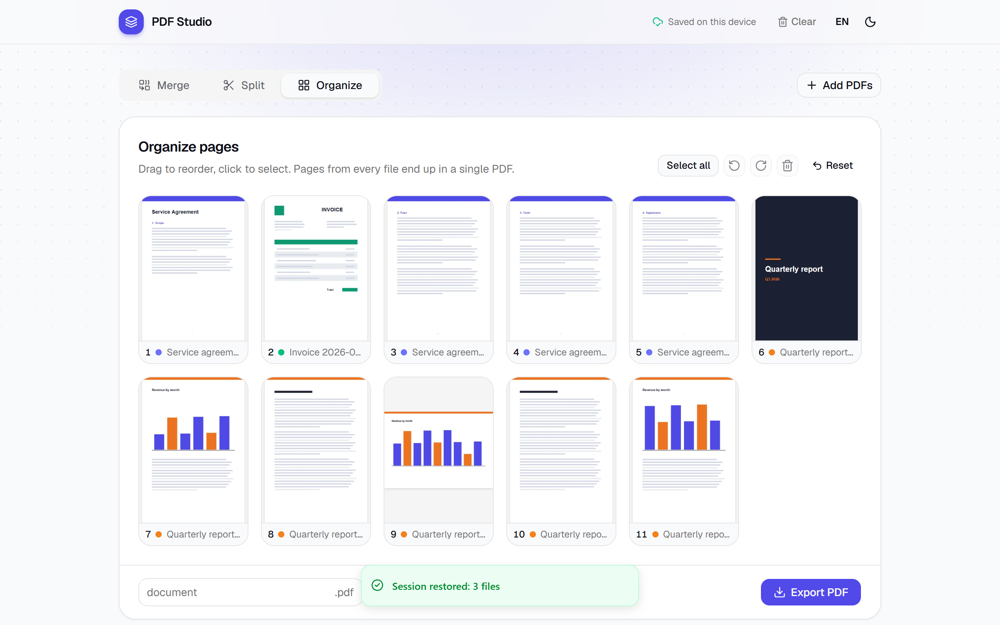
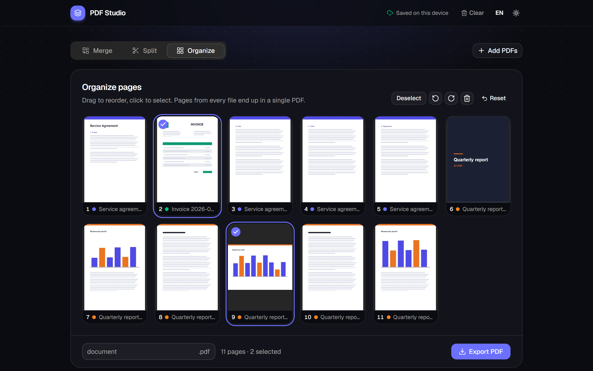
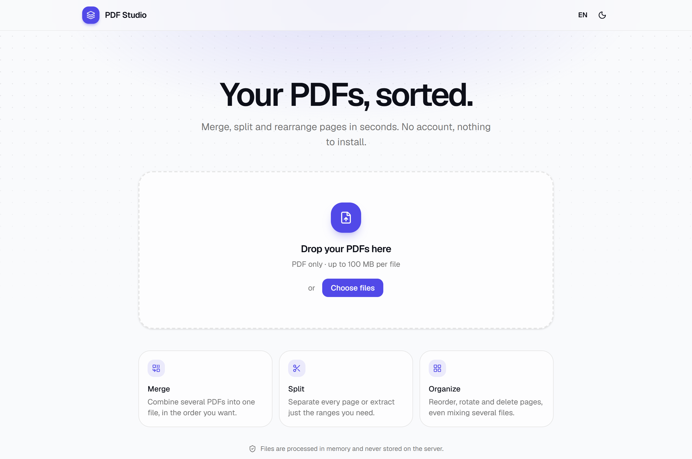
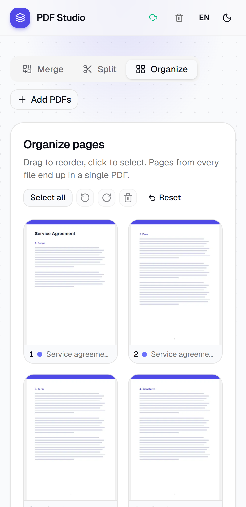

<p align="center">
  <picture>
    <source media="(prefers-color-scheme: dark)" srcset="assets/brand/Logo_PdfStudio_White.png">
    
  </picture>
</p>

<h3 align="center">Merge, split and rearrange PDFs. Nothing else in the way.</h3>

<p align="center">
  Drop your PDFs, put files and pages in the order you want, download the result.<br>
  Self-hosted, no account, no files kept on the server, and your work survives a crashed tab.
</p>

<p align="center">
  <a href="#run-it-in-two-minutes">Run it</a> ·
  <a href="#features">Features</a> ·
  <a href="#how-it-works">How it works</a> ·
  <a href="README_IT.md">Italiano</a>
</p>

<p align="center">
  
  
  
  
  <a href="LICENSE"></a>
  
</p>

<p align="center">
  
</p>

## Why PDF Studio

Joining two contracts, pulling three pages out of a report, turning a scan the right way up: small jobs that usually
end on a website nobody in the company has vetted, or in a desktop suite that needs a licence. PDF Studio does those
jobs, and only those, on a server you control:

- **Nothing to learn.** Three tools (Merge, Split, Organize), drag and drop everywhere, a preview of every page.
- **No account, no sign-up.** Open the page and work. There are no users, sessions or passwords to manage.
- **Your documents stay yours.** The server keeps a file in memory only while it builds the result: nothing is written
  to disk and there is no telemetry.
- **A crashed tab is not lost work.** Files and edits are cached in the browser: reload the page, or reopen it after a
  crash, and everything is back as you left it.
- **English and Italian**, light and dark theme, usable from a phone.

## See it

<table>
  <tr>
    <td width="50%"><br><b>Merge</b>: drag the files into the order you want, name the result, download one PDF.</td>
    <td width="50%"><br><b>Split</b>: every page, every N pages, or ranges. Each page shows the PDF it will end up in.</td>
  </tr>
  <tr>
    <td width="50%"><br><b>Crash recovery</b>: after a reload or a crash the session is restored from the browser cache.</td>
    <td width="50%"><br><b>Organize</b>, here in the dark theme: pages of every file in one grid, reordered, rotated, deleted.</td>
  </tr>
  <tr>
    <td width="50%"><br><b>Start page</b>: drop the files anywhere on the page, or choose them.</td>
    <td width="50%" align="center"><br><b>On a phone</b>: the same tools, laid out for a small screen.</td>
  </tr>
</table>

<sub>The screenshots show the real interface (version 1.0.0) with sample documents generated for the purpose.</sub>

## Features

### Merge
- Load **one or more PDFs**, by dropping them anywhere on the page or with the file picker.
- **Drag the files** into order; they are joined from top to bottom into a single PDF with the name you choose.

### Split
- **Every page** becomes its own PDF, or the file is cut **every N pages**.
- **Ranges** such as `1-3, 5, 8-` (`8-` means "from page 8 to the end"): one PDF per range, or all ranges combined
  into a single PDF to extract just the pages you need.
- **Live preview**: each page is marked with the PDF it will go into; pages left out are dimmed.
- Several output files are downloaded as **one ZIP**, named so that they sort in page order.

### Organize
- **One grid with the pages of every file**: drag to reorder, mixing pages from different documents.
- **Rotate** and **delete** single pages or a selection; **Reset** puts everything back.
- Each page shows which file it comes from. The result is exported as a new PDF.

### Crash recovery and privacy
- **Cached in the browser** (IndexedDB): the PDFs and what you were doing with them. After a reload, a closed tab or a
  crash the session is restored; an error screen offers to reload or to clear everything.
- **Clear** removes the files from the device. Nothing has to be removed from the server, because nothing is kept there.
- **Files are validated when added**: what is not a PDF, is damaged or is password protected is refused with the reason.

## Run it in two minutes

You need Docker.

```bash
git clone https://github.com/NEXQsrl/PDF-Studio.git
cd PDF-Studio
docker compose up -d --build
```

Open `http://<server>:5677`.

**With Portainer**: *Stacks > Add stack > Repository*, the URL of this repository and `docker-compose.yml` as the
compose path. The image is built from the `Dockerfile`, so the *Web editor* method does not work.

| Variable | Default | Meaning |
| --- | --- | --- |
| `PORT` | `5677` in the container, `3001` otherwise | Port the server listens on |
| `MAX_FILE_MB` | `100` | Largest PDF accepted. If you change it, change `MAX_FILE_MB` in `client/src/store.ts` too |
| `MAX_FILES` | `50` | Files accepted in one request |

PDF Studio has **no authentication**: anyone who can reach the port can use it. Publish it only on a network you trust,
or behind a reverse proxy that handles access (and whose upload limit is at least `MAX_FILE_MB`). The compose file
limits the container to 2 GB of memory, because PDFs are processed in memory: raise it if many large files are worked
on at the same time.

### Requirements
- Docker, or Node.js 20 or later to run it without a container.
- A current browser (Chrome, Edge, Firefox, Safari).

## How it works

```
Browser                                    Server (Express)
┌──────────────────────────────┐           ┌─────────────────────────────┐
│ React + shadcn/ui            │  PDFs +   │ POST /api/process           │
│ pdf.js      page previews    │  plan     │ pdf-lib   builds the PDFs   │
│ IndexedDB   files + session  │ ────────► │ in memory, nothing on disk  │
│                              │ ◄──────── │                             │
└──────────────────────────────┘ PDF / ZIP └─────────────────────────────┘
```

The browser never edits a PDF: it shows previews and lets you describe the result. Merge, split and organize all end
in the same request, the files it needs plus a **plan**:

```json
{ "outputs": [{ "name": "merged", "pages": [{ "file": 0, "page": 0, "rotate": 90 }] }] }
```

The server builds each output with pdf-lib and answers with a PDF, or with a ZIP when there is more than one.

```
client/   React + Vite + Tailwind + shadcn/ui
  src/store.ts          state (zustand) and saving of the session
  src/lib/storage.ts    IndexedDB cache
  src/lib/pdf.ts        previews with pdf.js
  src/lib/i18n.tsx      English and Italian texts
server/   Express + pdf-lib
  src/index.js          POST /api/process
  src/pdf.js            building of the PDFs
```

## Project status

Version 1.0.0. Known limits:

- **Password-protected PDFs** are not supported and are refused when added.
- **Bookmarks and interactive forms** of the original documents can be lost when merging or splitting.
- The cache uses the storage the browser grants to the site: when it is full, or in a private window, the files still
  work but are not restored after a restart (the app says so).

## Building from source

```bash
npm install
npm run dev      # client on http://localhost:5173, API on http://localhost:3001
npm test         # server tests
npm run build    # production build of the client
npm start        # Express serves the API and the built client on http://localhost:3001
```

## Security

There are no accounts and no stored documents: uploaded files live in the memory of the server only for the duration
of a request, and file names are sanitized before they are used. The container runs as a non-root user on a read-only
file system. Because there is no authentication, access control is up to the network or the reverse proxy in front of
it. **To report a vulnerability, do not open a public issue**: contact NEXQ through [www.nexq.it](https://www.nexq.it).

## License

PDF Studio is developed by [NEXQ](https://www.nexq.it) and released under the
**[PolyForm Shield License 1.0.0](https://polyformproject.org/licenses/shield/1.0.0)** ([LICENSE](LICENSE)), a standard
source-available license:

- **Free for personal and business use**, including production use in companies, with no limit on users or
  installations.
- **The source code is publicly available**: you can study it, modify it and build on it, and distribute copies with
  the license and the `Required Notice` line.
- **Reselling PDF Studio is not allowed**: the license forbids providing any product that competes with PDF Studio, so
  selling it, selling modified or renamed versions, or offering it as a competing product or service is not allowed.
- **Additional commercial rights**: contact NEXQ through [www.nexq.it](https://www.nexq.it).

It is not an OSI-approved open-source license (GitHub shows it as "Other"). Third-party components keep their own
licenses: see [NOTICE](NOTICE).

Copyright (c) NEXQ S.r.l. · [www.nexq.it](https://www.nexq.it)
