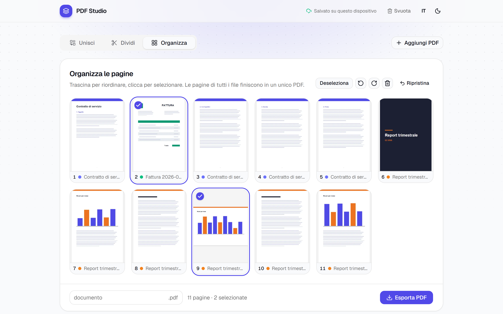
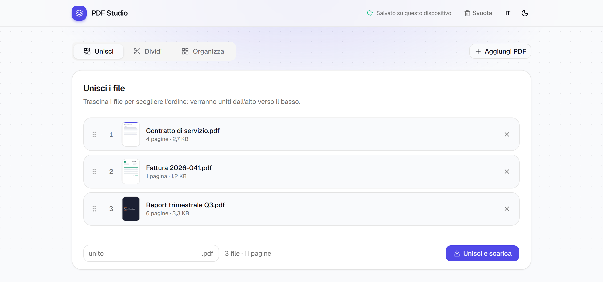
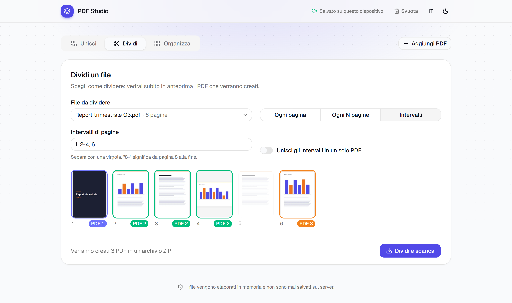
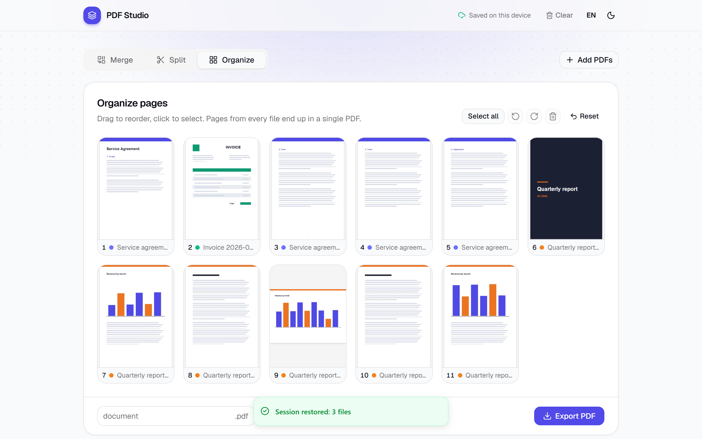
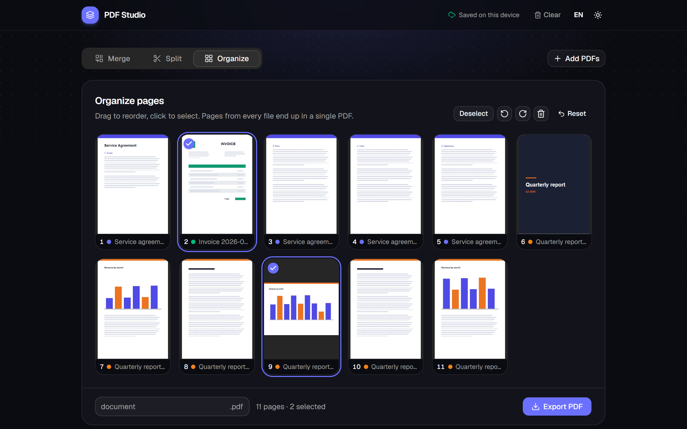
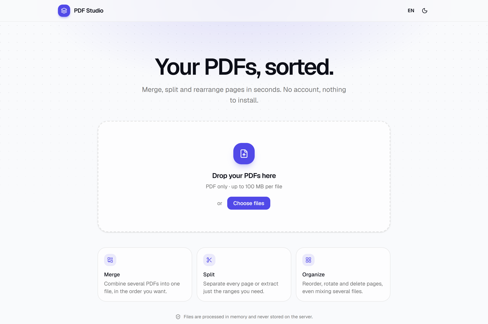
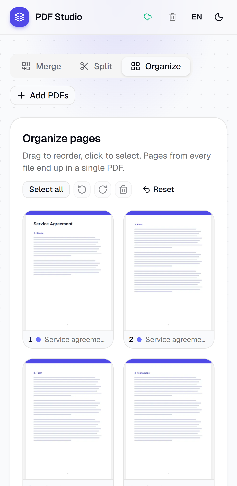

<p align="center">
  <picture>
    <source media="(prefers-color-scheme: dark)" srcset="assets/brand/Logo_PdfStudio_White.png">
    
  </picture>
</p>

<h3 align="center">Unisci, dividi e riordina i PDF. Senza nient'altro di mezzo.</h3>

<p align="center">
  Trascina i PDF, metti file e pagine nell'ordine che vuoi, scarica il risultato.<br>
  Installato sul tuo server, senza account, senza file conservati sul server, e il lavoro sopravvive a un crash della scheda.
</p>

<p align="center">
  <a href="#avvio-in-due-minuti">Avvio</a> ·
  <a href="#funzionalità">Funzionalità</a> ·
  <a href="#come-funziona">Come funziona</a> ·
  <a href="README.md">English</a>
</p>

<p align="center">
  
  
  
  
  <a href="LICENSE"></a>
  
</p>

<p align="center">
  
</p>

## Perché PDF Studio

Unire due contratti, estrarre tre pagine da un report, raddrizzare una scansione: piccoli lavori che di solito
finiscono su un sito che in azienda nessuno ha verificato, oppure in una suite desktop che richiede una licenza.
PDF Studio fa questi lavori, e solo questi, su un server che controlli tu:

- **Niente da imparare.** Tre strumenti (Unisci, Dividi, Organizza), trascinamento ovunque, anteprima di ogni pagina.
- **Nessun account, nessuna registrazione.** Apri la pagina e lavori. Non ci sono utenti, sessioni o password da gestire.
- **I documenti restano tuoi.** Il server tiene un file in memoria solo mentre costruisce il risultato: niente viene
  scritto su disco e non c'è telemetria.
- **Una scheda in crash non è lavoro perso.** File e modifiche sono salvati nel browser: ricarica la pagina, o riaprila
  dopo un crash, e ritrovi tutto com'era.
- **Italiano e inglese**, tema chiaro e scuro, utilizzabile anche da telefono.

## Com'è

<table>
  <tr>
    <td width="50%"><br><b>Unisci</b>: trascina i file nell'ordine che vuoi, dai un nome al risultato, scarica un solo PDF.</td>
    <td width="50%"><br><b>Dividi</b>: ogni pagina, ogni N pagine, oppure intervalli. Ogni pagina mostra in quale PDF finirà.</td>
  </tr>
  <tr>
    <td width="50%"><br><b>Ripristino dopo un crash</b>: dopo un ricaricamento o un crash la sessione viene ripresa dalla cache del browser.</td>
    <td width="50%"><br><b>Organizza</b>, qui nel tema scuro: le pagine di tutti i file in un'unica griglia, riordinate, ruotate, eliminate.</td>
  </tr>
  <tr>
    <td width="50%"><br><b>Pagina iniziale</b>: trascina i file in qualsiasi punto della pagina, oppure sceglili.</td>
    <td width="50%" align="center"><br><b>Su telefono</b>: gli stessi strumenti, disposti per uno schermo piccolo.</td>
  </tr>
</table>

<sub>Le schermate mostrano l'interfaccia reale (versione 1.0.0) con documenti di esempio generati allo scopo; alcune sono in inglese.</sub>

## Funzionalità

### Unisci
- Carica **uno o più PDF**, trascinandoli in qualsiasi punto della pagina o scegliendoli dal disco.
- **Trascina i file** per ordinarli: vengono uniti dall'alto verso il basso in un unico PDF con il nome che scegli.

### Dividi
- **Ogni pagina** diventa un PDF a sé, oppure il file viene tagliato **ogni N pagine**.
- **Intervalli** come `1-3, 5, 8-` (`8-` significa "da pagina 8 alla fine"): un PDF per intervallo, oppure tutti gli
  intervalli uniti in un solo PDF, per estrarre soltanto le pagine che servono.
- **Anteprima immediata**: ogni pagina è contrassegnata con il PDF in cui finirà; le pagine escluse sono attenuate.
- Più file in uscita vengono scaricati in **un unico ZIP**, con nomi che restano in ordine di pagina.

### Organizza
- **Un'unica griglia con le pagine di tutti i file**: trascina per riordinare, anche mescolando pagine di documenti diversi.
- **Ruota** ed **elimina** una pagina o una selezione; **Ripristina** rimette tutto com'era.
- Ogni pagina indica il file da cui proviene. Il risultato viene esportato come nuovo PDF.

### Ripristino e riservatezza
- **Cache nel browser** (IndexedDB): i PDF e quello che ci stavi facendo. Dopo un ricaricamento, una scheda chiusa o un
  crash la sessione viene ripristinata; una schermata di errore propone di ricaricare o di svuotare tutto.
- **Svuota** rimuove i file dal dispositivo. Sul server non c'è nulla da rimuovere, perché non viene conservato nulla.
- **I file sono controllati al caricamento**: ciò che non è un PDF, è danneggiato o è protetto da password viene
  rifiutato, indicando il motivo.

## Avvio in due minuti

Serve Docker.

```bash
git clone https://github.com/NEXQsrl/PDF-Studio.git
cd PDF-Studio
docker compose up -d --build
```

Apri `http://<server>:5677`.

**Con Portainer**: *Stacks > Add stack > Repository*, l'URL di questo repository e `docker-compose.yml` come compose
path. L'immagine viene compilata dal `Dockerfile`, quindi il metodo *Web editor* non funziona.

| Variabile | Predefinito | Significato |
| --- | --- | --- |
| `PORT` | `5677` nel container, `3001` altrimenti | Porta su cui ascolta il server |
| `MAX_FILE_MB` | `100` | Dimensione massima di un PDF. Se la cambi, cambia anche `MAX_FILE_MB` in `client/src/store.ts` |
| `MAX_FILES` | `50` | File accettati in una richiesta |

PDF Studio **non ha autenticazione**: chiunque raggiunga la porta può usarlo. Pubblicalo solo su una rete di cui ti
fidi, oppure dietro un reverse proxy che gestisca l'accesso (e il cui limite di upload sia almeno `MAX_FILE_MB`). Il
compose limita il container a 2 GB di memoria, perché i PDF vengono elaborati in memoria: aumentalo se vengono lavorati
molti file grandi contemporaneamente.

### Requisiti
- Docker, oppure Node.js 20 o successivo per eseguirlo senza container.
- Un browser aggiornato (Chrome, Edge, Firefox, Safari).

## Come funziona

```
Browser                                    Server (Express)
┌──────────────────────────────┐           ┌─────────────────────────────┐
│ React + shadcn/ui            │  PDF +    │ POST /api/process           │
│ pdf.js      anteprime        │  piano    │ pdf-lib   costruisce i PDF  │
│ IndexedDB   file + sessione  │ ────────► │ in memoria, nulla su disco  │
│                              │ ◄──────── │                             │
└──────────────────────────────┘ PDF / ZIP └─────────────────────────────┘
```

Il browser non modifica mai un PDF: mostra le anteprime e ti lascia descrivere il risultato. Unione, divisione e
organizzazione finiscono tutte nella stessa richiesta, i file necessari più un **piano**:

```json
{ "outputs": [{ "name": "unito", "pages": [{ "file": 0, "page": 0, "rotate": 90 }] }] }
```

Il server costruisce ogni output con pdf-lib e risponde con un PDF, oppure con uno ZIP quando gli output sono più di uno.

```
client/   React + Vite + Tailwind + shadcn/ui
  src/store.ts          stato (zustand) e salvataggio della sessione
  src/lib/storage.ts    cache IndexedDB
  src/lib/pdf.ts        anteprime con pdf.js
  src/lib/i18n.tsx      testi in italiano e inglese
server/   Express + pdf-lib
  src/index.js          POST /api/process
  src/pdf.js            costruzione dei PDF
```

## Stato del progetto

Versione 1.0.0. Limiti noti:

- I **PDF protetti da password** non sono supportati e vengono rifiutati al caricamento.
- **Segnalibri e moduli interattivi** dei documenti originali possono andare persi unendo o dividendo.
- La cache usa lo spazio che il browser concede al sito: quando è pieno, o in una finestra privata, i file funzionano
  comunque ma non vengono ripristinati dopo un riavvio (l'app lo segnala).

## Compilare dai sorgenti

```bash
npm install
npm run dev      # client su http://localhost:5173, API su http://localhost:3001
npm test         # test del server
npm run build    # build di produzione del client
npm start        # Express serve API e client compilato su http://localhost:3001
```

## Sicurezza

Non ci sono account né documenti conservati: i file caricati restano nella memoria del server solo per la durata di
una richiesta, e i nomi dei file vengono ripuliti prima di essere usati. Il container gira con un utente non root su un
file system in sola lettura. Non essendoci autenticazione, il controllo degli accessi spetta alla rete o al reverse
proxy che gli sta davanti. **Per segnalare una vulnerabilità non aprire una issue pubblica**: contatta NEXQ tramite
[www.nexq.it](https://www.nexq.it).

## Licenza

PDF Studio è sviluppato da [NEXQ](https://www.nexq.it) e rilasciato con la
**[PolyForm Shield License 1.0.0](https://polyformproject.org/licenses/shield/1.0.0)** ([LICENSE](LICENSE)), una
licenza standard di tipo source-available:

- **Gratuito per uso personale e aziendale**, anche in produzione, senza limiti di utenti o di installazioni.
- **Il codice sorgente è pubblico**: puoi studiarlo, modificarlo e usarlo come base, e distribuirne copie insieme alla
  licenza e alla riga `Required Notice`.
- **Non è consentito rivendere PDF Studio**: la licenza vieta di fornire qualsiasi prodotto in concorrenza con
  PDF Studio, quindi non è consentito venderlo, vendere versioni modificate o rinominate, né offrirlo come prodotto o
  servizio concorrente.
- **Diritti commerciali aggiuntivi**: contatta NEXQ tramite [www.nexq.it](https://www.nexq.it).

Non è una licenza open source approvata da OSI (GitHub la mostra come "Other"). I componenti di terze parti mantengono
le proprie licenze: vedi [NOTICE](NOTICE). Fa fede il testo inglese della licenza.

Copyright (c) NEXQ S.r.l. · [www.nexq.it](https://www.nexq.it)
